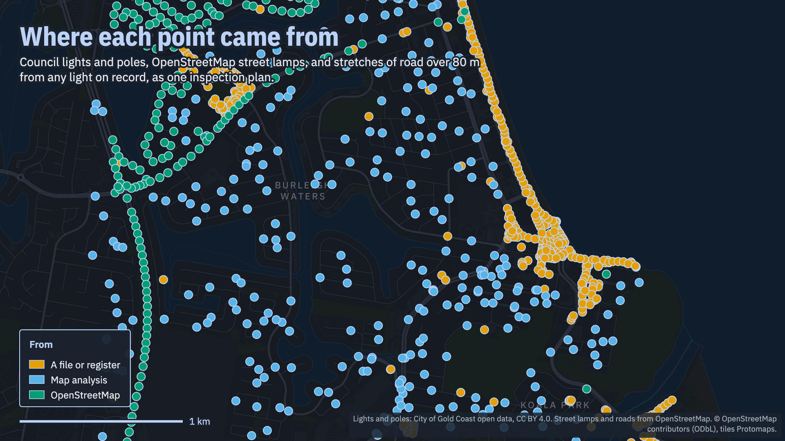

# Inspection points: which street lights are out, which drains to clean

Two inspection plans for Burleigh Heads and Miami on the Gold Coast, made in Plotlay from open data. **Lights:** the City of Gold Coast's 420 lights and 348 poles, 174 street lamps from OpenStreetMap that the council register does not hold, and 294 stretches of road more than 80 m from any light on record, as one plan, with a simulated night patrol. **Stormwater:** 2,231 inlet pits and 158 outlets, a simulated silt survey of 600 pits, a cleaning priority and a cleaning run of the top 40 before rain. **Live version, with the method:** [getplotlay.com/showcase/inspection-points](https://www.getplotlay.com/showcase/inspection-points/)



**One plan from three sources.** Each point keeps where it came from and says in plain words why it is there: "City of Gold Coast lights: 000000006000000865", "OSM highway=street_lamp node 5960447709", "1815 m of Burleigh Street more than 80 m from any light on record". 53 OpenStreetMap lamps stood within 10 m of a council light and were merged into it rather than added twice.

**The simulated night patrol** drove nine streets (6.0 km) at 8 pm on 24 November, after dark (sunset 6.22 pm, dark from 6.49 pm at those streets, worked out by Plotlay from the location and date), past 21 planted faults (20 lights not lit, one tree in the way), with GPS noise. Each tap went to the nearest light within 35 m, preferring one ahead of or beside the direction of travel. 19 of 21 went to the right light; 5 were flagged to check (over 20 m away, or a close second), including one of the two wrong ones. The other wrong one was marked fine, which is why the review shows each match on the map before it is applied. 114 lights were recorded (93 lit, 21 faults). A light recorded not lit sets its working status, never its condition rating, and raises a fault to its owner. The faults became 21 repairs, A$6,282 at the price book's rates (A$9,266 with the estimate's allowances and GST). 20 of the faults were on OpenStreetMap lamps with no owner stated and 1 on a state road light: in a real patrol those go to the electricity network and the state roads authority, not the council.

**The pits before the wet.** 600 pits in a made-up silt survey, scored 0 to 100 from silt (weight 50) and the length of pipe draining through each pit (weight 30), from a trace of the council's 80.9 km of pipes. 93 need cleaning and 26 a grate or lid repair: 119 repairs, A$24,769 at the rates (A$36,533 with allowances and GST). The top 40 make a cleaning run of 13.3 km.

[](https://app.plotlay.io/?example=inspection-points&as=client)

## Read this first

- **The patrol and the silt survey are simulated.** No one drove those streets or lifted those lids. The faults were planted on real lights, the taps made with GPS noise, and the silt shares drawn at random. They show the workflow and how well the matching works, not the state of Burleigh's lights or drains.
- **Condition ratings and scores are prioritisation aids, not engineering assessments.** The cleaning weights are a choice; change them and the order changes. No open flood-prone area layer covers this area, so the flood weight is not used.
- **Costs are indicative**: Plotlay price book lines (labour hours at a trade rate plus materials, with a low to high range), not quotes. Real costs depend on access, traffic management and the market.
- **Accuracy depends on the sources.** The council gives a positional accuracy class for many of its assets (`accuracy`, `accuracy_m`); OpenStreetMap lamps are where a volunteer mapped them; a dark stretch is the middle of the stretch.
- **Dark stretches and expected positions are a check on the record**, not a lighting design or a lux calculation. Most Queensland road lighting belongs to the electricity network, so a council register shows mostly the council's own park, path and car park lights; many dark stretches are lit by lights that are simply not in this data.
- **The site plan is made up** (`data/site/`): a community centre that does not exist, drawn to show how a lighting drawing's blocks become inspection points. Its emergency lighting test is simulated. The test record follows AS/NZS 2293.2 as a reference only.

## What's here

| Folder | What |
|---|---|
| [`data/`](data) | `lights.csv` and `lights.geojson`: the lights plan, every point with its kind, owner, status, what was found, where it came from, why it is there and its accuracy. `pits.csv` and `pits.geojson`: the pits plan with the simulated survey. `patrol_trace.csv`: the simulated drive's GPS fixes. `patrol_taps.csv`: each tap, the light it was matched to, the distance, whether it was ahead, the match status, and the light the fault was planted on. `expected_lights.csv`: one position every 60 m along the roads where no light is on record (flagged "expected, not mapped"). `cleaning_priority.csv`: every pit with its score, silt, catchment and rank. `repairs.csv`: the 140 repairs, priced. `site/`: the made-up site DXF, its points and its test record. `numbers.json`: every number above. |
| [`python/`](python) | A narrated notebook ([`inspection_points.ipynb`](python/inspection_points.ipynb)) that reads the files back: the sources, owners and accuracy, the patrol matches against the planted faults, the cleaning priority worked out again, and the repairs |
| [`visuals/`](visuals) | Map pictures made in Plotlay |

### Run the notebook

```
python3 -m venv .venv
.venv/bin/pip install -r python/requirements.txt
cd python && ../.venv/bin/jupyter lab inspection_points.ipynb
```

## How it was made

1. **Lights and poles**: the council's lights and poles layers for the area, read into one plan; each light linked to the pole it stands on (309 of 420). Kinds come from the council's lighting type and purpose (path, flood, car park, street, bollard, internal).
2. **OpenStreetMap**: `highway=street_lamp` nodes in the area (227), merged with a council light within 10 m (53) or added (174).
3. **Roads**: 546 OpenStreetMap road ways, 88.6 km. Plotlay walked each road for stretches more than 80 m from any light on record (294 stretches, 59.6 km) and put a point in the middle of each.
4. **The patrol**: nine streets, a simulated drive at 36 km/h, a GPS fix a second with 4 m noise, a tap per planted fault. Plotlay's night patrol matches each tap and the review shows every match on the map before Apply.
5. **Stormwater**: the council's pits, end structures and pipes. Pipes joined into a network at 0.5 m (3,720 lines, 210 roots at outlets and the area's edge); the length of pipe upstream of each pit from that trace.
6. **The cleaning run**: the top 40 scored pits in visiting order.
7. **Repairs**: a repair per fault and per pit needing work, priced in Plotlay's Estimates.

## Sources and licences

- Lights, poles, stormwater pits, end structures and pipes: City of Gold Coast Open Data, [CC BY 4.0](https://creativecommons.org/licenses/by/4.0/).
- Street lamps and roads: © OpenStreetMap contributors, [ODbL](https://opendatacommons.org/licenses/odbl/). Extract of 24 November 2026.

The council-derived data in `data/` is CC BY 4.0 (`LICENSE-DATA`); please credit "Inspection points: Plotlay (getplotlay.com), from City of Gold Coast open data and OpenStreetMap". Rows from OpenStreetMap (`source` OSM, `expected_lights.csv`, the dark stretches) are under the ODbL. The notebook is MIT (`LICENSE`). This is independent work using open data, not endorsed by the City of Gold Coast.
